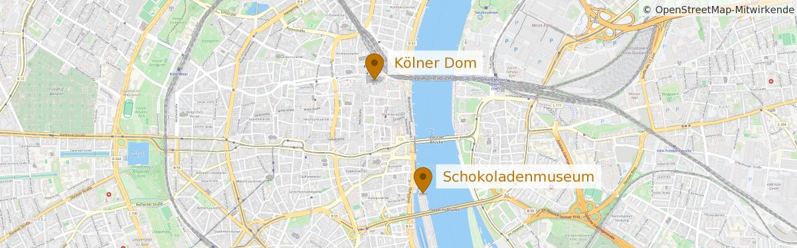

# Karte aus OpenStreetMap für Contao 5

Ein Inhaltselement für Karten. Einzutragen ist nur die Anschrift — Kartenbild und
Verlinkung entstehen beim Speichern von selbst.

**Beim Aufruf der Seite wird kein fremder Server angefragt.** Das Kartenbild liegt fertig
im Dateimanager und wird von der eigenen Website ausgeliefert; ein Zustimmungsbanner ist
dafür nicht nötig. Nur beim Speichern im Backend holt der Server einmalig die Kartenkacheln.



## Was das Element kann

* **Anschrift eintragen, fertig.** „Domkloster 4, 50667 Köln“ genügt. Nach dem
  Speichern steht in der Meldung, welche Position gefunden wurde. Eine Postleitzahl oder
  ein Ortsteil reichen ebenfalls.
* **Koordinaten statt Anschrift**, wenn es keine gibt — Neubaugebiete tragen oft noch keine
  Hausnummern: `50.9413035, 6.9581380`. Die Erkennung ist automatisch, es wird dann gar
  nicht erst gesucht.
* **Beliebig viele Markierungen** in einem Feld — dem *Zeilen-Wizard* von Contao 5.7
  (`rowWizard`, reines Bordmittel). Je Zeile eine Anschrift und eine Beschriftung; die
  Beschriftung erscheint als kleines Schild neben dem Punkt, etwa „Kölner Dom“.
  Zeilen lassen sich mit den Contao-eigenen Bedienelementen hinzufügen, kopieren, löschen
  und **per Ziehen sortieren**.

  Die **oberste Zeile ist die Hauptanschrift**: Auf sie zeigt der Klick auf die Karte, und
  ohne Nummer meinen auch die Platzhalter im Balken diese Zeile.
* **Maßstab wählbar** (Stufe 3–19, jeweils mit Erläuterung: „15 – Straße mit Umgebung“) —
  oder **automatisch**, die Vorgabe: Dann wird der Ausschnitt so gewählt, dass alle
  Markierungen hineinpassen, mit etwas Rand für die Schilder.
* **Klick auf das Bild** — fünf Möglichkeiten:

  | Auswahl | Ziel |
  | --- | --- |
  | Karte öffnen in OpenStreetMap | openstreetmap.org, Markierung auf der Adresse |
  | Karte öffnen in Google Maps | google.com/maps, Markierung auf der Adresse |
  | Routenplanung öffnen in OpenStreetMap | Ziel eingetragen, Start trägt der Besucher ein |
  | Routenplanung öffnen in Google Maps | ebenso, bei Google |
  | nicht verlinken | das Bild bleibt ohne Link |

* **Beschriftung über dem unteren Bildrand** — ein schmaler, halbdurchsichtiger Balken.
  Der Text ist frei, einzelne Wörter werden zu Links:

  ```
  Adresse öffnen in {osm} oder {google}
  ```

  Daraus wird: *Adresse öffnen in [OpenStreetMap] oder [Google Maps]*. Es stehen dieselben
  vier Ziele zur Verfügung wie beim Klick auf das Bild:

  | Platzhalter | Ziel |
  | --- | --- |
  | `{osm}` | Karte bei OpenStreetMap |
  | `{google}` | Karte bei Google Maps |
  | `{route}` | Routenplanung bei OpenStreetMap |
  | `{route-google}` | Routenplanung bei Google Maps |

  Ein Textfeld statt eines Auswahlfelds, weil ein Satz **mehrere** Links enthalten kann —
  die Voreinstellung nutzt genau das. Wer nur einen Link möchte, schreibt eben nur einen
  Platzhalter. Eigene Beschriftung mit `{osm:Karte ansehen}`; leer lassen = kein Balken.

  **Bei mehreren Markierungen** wählt eine angehängte Nummer die gemeinte aus — `{osm-2}`
  führt zur zweiten Zeile des Wizards. Ein solcher Platzhalter trägt als Linktext die
  **Beschriftung dieser Markierung**, denn bei mehreren Orten ist deren Name die nützliche
  Auskunft und nicht der Name des Kartendienstes:

  ```
  Standorte ansehen: {osm-1} und {osm-2} · Route: {route-google-2}
  ```

  Daraus wird: *Standorte ansehen: [Kölner Dom] und [Schokoladenmuseum] · Route:
  [Schokoladenmuseum]*. Ohne Nummer bleibt es beim Namen des Dienstes und bei der ersten
  Markierung — bestehende Texte verhalten sich also unverändert. Verweist eine Nummer ins
  Leere, bleibt der Platzhalter sichtbar stehen, statt still zu verschwinden.
* **Farbe der Markierung** einstellbar, ebenso Breite und Höhe (Vorgabe 1920 × 600). Das
  sind die **Anzeigemaße**: Erzeugt wird das Bild mit der doppelten Auflösung, damit es auf
  hochauflösenden Bildschirmen scharf bleibt (siehe „Scharf auf Retina-Bildschirmen“).
* **Zweites Bild für schmale Bildschirme**, wahlweise. Ein breites, flaches Kartenbild wird
  auf dem Telefon entweder sehr klein oder es zeigt nach dem Zuschneiden die Umgebung statt
  des Ortes. Mit dem Haken entsteht beim Speichern eine zweite Fassung in eigenem Format —
  meist quadratisch (Vorgabe 800 × 800), sichtbar bis 767 Pixel Fensterbreite. Beide Fassungen
  stecken in einem `<picture>`; übertragen wird immer nur die, die der Browser tatsächlich
  anzeigt. Der Ausschnitt ist derselbe Ort, bei automatischem Maßstab mit einer eigens
  berechneten Stufe — ins Quadrat passt seitlich weniger, dafür senkrecht mehr.
* Das Bild ist eine gewöhnliche Datei im Dateimanager — die **Bildgrößen von Contao**
  greifen also ganz normal.

## Installation

```bash
composer require heimseiten/contao-osm-map-bundle
vendor/bin/contao-console contao:migrate
```

Voraussetzungen: Contao ^5.3, PHP ^8.2 und die Bildbibliothek **GD** mit
JPEG-Unterstützung. GD steht als `ext-gd` in der `composer.json` — fehlt sie, verweigert
Composer die Installation und sagt das, statt später beim Speichern zu scheitern.

Eine **Schrift muss auf dem Server nicht installiert sein**: Das Bundle bringt eine mit
(`res/fonts/`, DejaVu Sans auf die europäischen Latein-Bereiche gekürzt, 45 KB, freie
Lizenz). Nur wenn GD ohne FreeType-Unterstützung übersetzt wurde — selten, aber möglich —
bleiben die Schilder weg; die Karte selbst entsteht dann trotzdem. Was vorhanden ist,
zeigt eine `phpinfo()`-Ausgabe im Abschnitt *gd* unter „FreeType Support“.

Beim **Speichern** muss der Server ausgehende Verbindungen zu
`nominatim.openstreetmap.org` und `tile.openstreetmap.org` aufbauen dürfen. Für Besucher
gilt das nicht — für sie ist die Karte ein Bild von der eigenen Domain.

## Scharf auf Retina-Bildschirmen

Auf hochauflösenden Bildschirmen besteht ein CSS-Pixel aus zwei Bildpunkten. Ein Bild,
das genau so groß erzeugt wurde, wie es dargestellt wird, wirkt dort weich. Deshalb sind
Breite und Höhe im Backend die **Anzeigemaße**, und das Bild entsteht mit der doppelten
Auflösung: Aus 1920 × 600 wird eine Datei mit 3840 × 1200 Bildpunkten. Für die Karte
selbst wird dazu eine Zoomstufe tiefer geladen — derselbe Ausschnitt, nur mit vier Mal so
vielen Kacheln; Markierungen, Schilder und die Namensnennung werden entsprechend größer
gezeichnet.

Damit Besucher nicht die große Datei laden, gehört dem Karten-Element eine **Bildgröße**
zugewiesen (Feld *Bildgröße*, weiter unten in der Maske). Contao erzeugt daraus die
passenden Fassungen samt `srcset` und, sofern in der Bildgröße aktiviert, WebP und AVIF —
ein normaler Bildschirm bekommt dann die einfache, ein Retina-Bildschirm die doppelte
Auflösung. **Ohne zugewiesene Bildgröße liefert Contao das Original aus**, und die Seite
wird durch die hohe Auflösung langsamer statt besser.

## Zwei Formate: breit und schmal

Dieselbe Karte in zwei Zuschnitten, damit sie auf dem Telefon nicht zur Briefmarke wird:

| Feld | Vorgabe | Bedeutung |
| --- | --- | --- |
| Zweites Bild für schmale Bildschirme | aus | Schaltet die zweite Fassung ein |
| Breite / Höhe des schmalen Kartenbildes | 800 × 800 | Anzeigemaße; gleiche Werte ergeben ein Quadrat |
| Zweites Bild anzeigen bis | 767 | Fensterbreite, bis zu der die schmale Fassung gilt |
| Bildgröße für das schmale Bild | — | Eigene Bildgröße, weil das Seitenverhältnis abweicht |

Die schmale Fassung braucht eine **eigene** Bildgröße: Eine auf das breite Bild
zugeschnittene Größe würde das Quadrat beschneiden. Ohne Angabe wird die Datei
unverkleinert ausgeliefert — und sie entsteht, wie die breite, in doppelter Auflösung.

Beide Fassungen liegen als Quellen in einem einzigen `<picture>`. Das ist bewusst so und
nicht als zweites Bild mit `display: none` gelöst: Ein ausgeblendetes `` würde
trotzdem geladen, der Besucher bekäme also beide Dateien.

## Einstellungen

Beides ist optional — ohne Angabe gelten die Vorgaben.

```yaml
# config/config.yaml
parameters:
    # Wohin die erzeugten Kartenbilder gelegt werden (wird bei Bedarf angelegt,
    # samt der Markierung .public, ohne die Contao nichts daraus ausliefert)
    heimseiten_osm_map.ordner: 'files/karten'

    # Womit sich die Website bei OpenStreetMap meldet. Die Nutzungsbedingungen verlangen
    # eine aussagekräftige Angabe — bitte die eigene Adresse eintragen.
    heimseiten_osm_map.user_agent: 'Meine Website (https://www.example.org/)'
```

## Alle Karten neu erzeugen

Nötig etwa nach einem Umzug auf einen anderen Server, wenn die Bilddateien fehlen:

```bash
vendor/bin/contao-console heimseiten:osm-map:rebuild          # nur fehlende
vendor/bin/contao-console heimseiten:osm-map:rebuild --force  # alle
vendor/bin/contao-console heimseiten:osm-map:rebuild --id=42  # ein bestimmtes Element
```

Im Alltag ist der Befehl nicht nötig: Beim Speichern eines Elements entsteht das Bild
von selbst. Solange sich an den Einstellungen nichts ändert, wird OpenStreetMap gar nicht
erst angefragt.

## Gestaltung

**Das Standard-CSS liefert das Bundle mit** (`public/osm-map.css`). Es wird automatisch
eingebunden — aber nur auf Seiten, auf denen tatsächlich eine Karte steht. Im Theme muss
dafür nichts eingetragen werden. Enthalten sind: Bild auf volle Breite, der Balken am
unteren Rand samt Halbtransparenz, ein Mobil-Zustand mit kleinerer Schrift und die Sperre
gegen das Aufzoomen beim Überfahren (viele Themes vergrößern verlinkte Bilder — bei einer
Karte verschiebt das den Ausschnitt und verfälscht den Maßstab).

Eigene Anpassungen gehören ins Theme; die Regeln dort gewinnen, weil sie später geladen
werden:

```css
.osm-map            /* der Rahmen um alles */
.osm-map__flaeche   /* der Link um das Bild */
.osm-map__balken    /* die Beschriftung über dem unteren Bildrand */
```

Der Balken lässt Klicks durch (`pointer-events: none`), nur seine Links fangen sie ab —
ein Klick daneben landet also auf dem verlinkten Bild.

## Datenschutz und Lizenz der Kartendaten

* **Beim Seitenaufruf wird nichts nachgeladen.** Das Kartenbild liegt auf dem eigenen
  Server. Nachweisen lässt sich das mit den Entwicklerwerkzeugen des Browsers: unter den
  geladenen Ressourcen taucht kein fremder Host auf.
* **Beim Speichern** fragt der Server Nominatim (Adresssuche) und die Kartenkacheln an —
  mit aussagekräftigem User-Agent und höchstens einer Suchanfrage je Sekunde, wie es die
  Nutzungsbedingungen verlangen. Das Ergebnis wird gespeichert, nicht bei jedem Aufruf
  neu geholt.
* Die **Namensnennung „© OpenStreetMap-Mitwirkende“** ist nach der Lizenz der Daten (ODbL)
  Pflicht und wird fest ins Bild eingearbeitet — sie kann also nicht versehentlich
  verlorengehen.
* Wird ein Google-Ziel gewählt (beim Klick auf das Bild oder über `{google}` bzw.
  `{route-google}` im Balken), entsteht ein **Link** zu Google Maps. Ein Link allein lädt
  nichts nach; erst der Klick führt den Besucher dorthin. Wer das vermeiden will, wählt
  durchgehend die OpenStreetMap-Ziele.

## Hinweise

* Findet die Adresssuche nichts, erscheint beim Speichern eine Meldung und das bisherige
  Bild bleibt stehen. Meist hilft die Form „Straße Hausnummer, PLZ Ort“ — oder man trägt
  die Koordinaten ein.
* Die Bilder heißen nach der Anschrift und tragen einen kurzen Fingerabdruck der
  Einstellungen im Namen. Ändert sich der Maßstab, entsteht eine neue Datei; die alte
  bleibt liegen und kann im Dateimanager gelöscht werden.
* **Für die Schilder wird eine TrueType-Schrift benötigt.** Eine liegt bei; gesucht wird
  zuerst dort, danach an den üblichen Stellen des Systems (DejaVu, Liberation, FreeSans,
  Arial). Ohne FreeType-Unterstützung in GD bleiben die Punkte unbeschriftet — die
  eingebauten Schriften der Bildbibliothek können keine Umlaute, „Straße“ käme als
  „Stra?e“ heraus.
* Bei mehreren Markierungen zeigt der Klick auf die Karte weiterhin auf die
  **Hauptanschrift** (oberste Zeile), nicht auf den rechnerischen Mittelpunkt. Einzelne
  Orte lassen sich über die Platzhalter im Balken ansteuern.

## Lizenz

GPL-3.0-or-later · [heimseiten.de – Webdesign aus Köln](https://www.heimseiten.de/)
